<style>
  .col2 {
    columns: 2 200px;         /* number of columns and width in pixels*/
    -webkit-columns: 2 200px; /* chrome, safari */
    -moz-columns: 2 200px;    /* firefox */
  }
  .col3 {
    columns: 3 100px;
    -webkit-columns: 3 100px;
    -moz-columns: 3 100px;
  }
slides > slide {
  overflow-x: auto !important;
  overflow-y: auto !important;
}
</style>

## Objectifs du cours

- Qu'est-ce qu'un plan de gestion ?
- Pourquoi faire un plan de gestion ?
- Comment faire un plan de gestion ?

# Introduction

## Introduction

Un plan de gestion est un document cadre qui fixe les enjeux et les objectifs de la gestion des espaces naturels.

Méthodolgie commune : CT88 porté par l'OFB

https://ct88.espaces-naturels.fr/

Contenus et structure du document variable selon les espaces et les enjeux, par conséquent un plan de gestion peu être succinct (< 10 pages) ou très long (plusieurs centaines de pages).

Il est défini pour une durée donnée, en général entre cinq ou dix ans.

## Introduction

Un plan de gestion est un document de planification.

Objectifs : 

- Définir, progammer, contrôler la gestion des milieux naturels

- Assurer à long terme la continuité de la gestion

- Organiser le travail à mettre en œuvre sur le terrain

- Transmettre et expliciter les choix de gestions aux acteurs et usagers locaux

## Schéma général d'un plan de gestion

<center>
```{r echo=FALSE, out.width = "250px"}
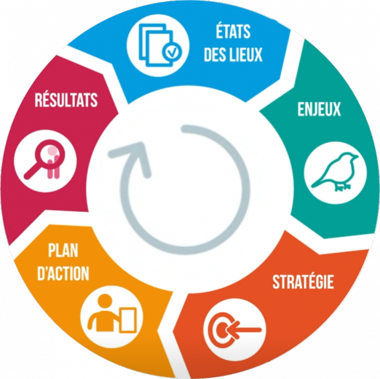
```

Démarche cyclique (notion de continuité et d'ajustement)

# Application des Plans de gestion

## Quels espaces sont concernés ?
<div class="col2">

- RNR, RNN

- RBD, RBI

- Sites CEN

- APPB

- Réserve de chasse et de faune sauvage

- Et tout autre site naturel – au sens large – géré avec un objectif de conservation de la biodiversité

En métropole et en outre-mer

```{r echo=FALSE, out.width = "200px", fig.align="center"}
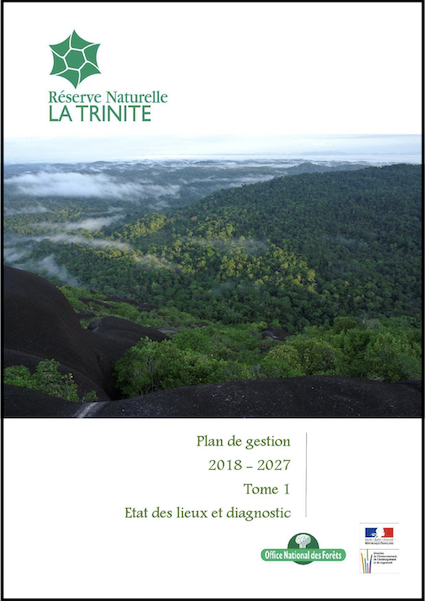
```

<font size="3">
Exemple : PG de la RNN de la Trinité (Guyane) en trois tomes !
</font>

</div>
## Qui rédige et applique des plans de gestion ?


### Rédaction : 

en régie ou extérieurs (Bureaux d'études)

### Application :

- Conservatoires d'espaces naturels (réseau de 25 CEN en France + outre-mer)

- Associations de protection de la Nature (LPO…)

- Collectivités territoriales (Régions, Départements, communautés de communes, communes)

- Industriels (carrières…)


## Quelques exemples
<div class="col3">

```{r echo=FALSE, out.width = "250px", fig.align="center", fig.cap="90 p."}
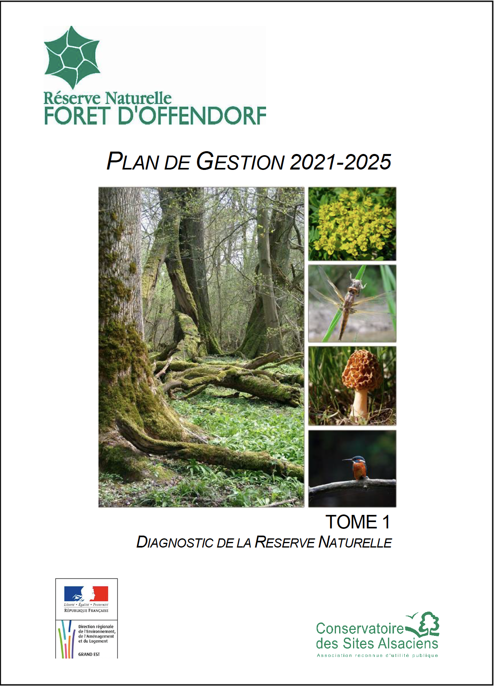
```

```{r echo=FALSE, out.width = "250px", fig.align="center", fig.cap="149 p."}
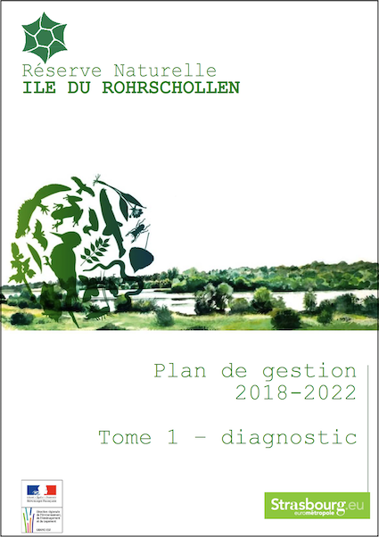
```

```{r echo=FALSE, out.width = "250px", fig.align="center", fig.cap="135 p."}
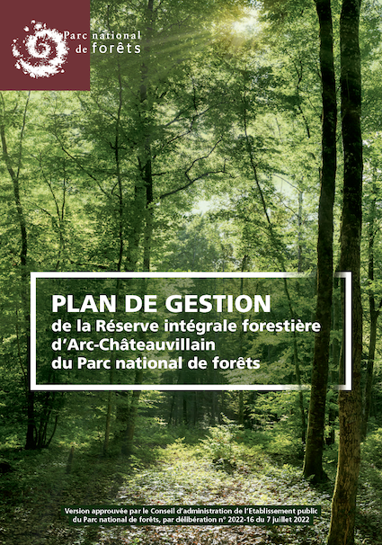
```

</div>

# Comment est construit un plan de gestion ?

## Plan type


- Diagnostic

- Gestion conservatoire

  <font size ="4">
  
    - Définition des enjeux

    - Définition des objectifs à long terme

    - Définition des objectifs opérationels

    - Description des opérations
  
  </font>

- Fiches actions

- Bibliographie

- Annexes (cartes, listes d'espèces…)

## Ce que contient un plan de gestion

- Liste des habitats patrimoniaux

- Listes des espèces animales et végétales patrimoniales

- Rappel des enjeux, des objectifs à long terme, des objectifs opérationels et des actions.

## Étape 1 : Le diagnostic
- Diagnostic écologique : faune, flore, habitats.

<font size="5">
  Les outils disponibles = Arrêtés de protection, Listes rouges, atlas de répartition, Cahiers d'Habitats…
</font>

- Diagnostic géologique
- Diagnostic archéologique
- Diagnostic hydrologique :
Régime des cours d'eau, identification des eaux stagnantes, connaissance des eaux souterraines.
- Diagnostic économique (e.g. agriculture)
- Diagnostic culturel : monuments, ouvrages, pratiques sportives et de loisir.


## Étape 1 : Le diagnostic

L'utilisation et la fréquentation des sites naturels varient dans l'espace (ville vs. forêt) et dans le temps (e.g. vacances en montagne ou à la mer).

Comment concilier tous ces éléments ? Quelles priorités ?

<u>Point de vigilance</u> : nécessité de veille bibliographique ( = actualisation des connaissances scientifiques)

## Étape 1 : Le diagnostic

```{r echo=FALSE, out.width = "500px", fig.align="center"}
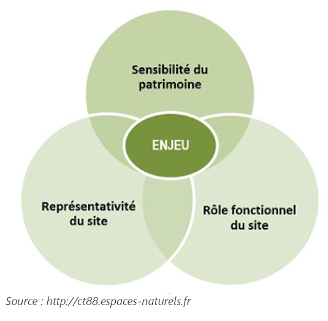
```


## Exemple : La RNR du Bocage des Antonins (79)

<div class="col2">

```{r echo=FALSE, out.width = "300px", fig.align="center"}
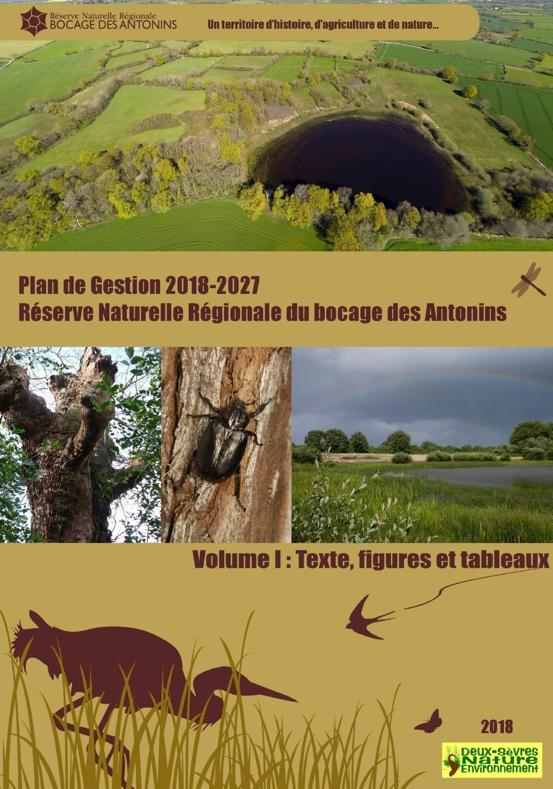
```


```{r echo=FALSE, out.width = "400px", fig.align="center"}
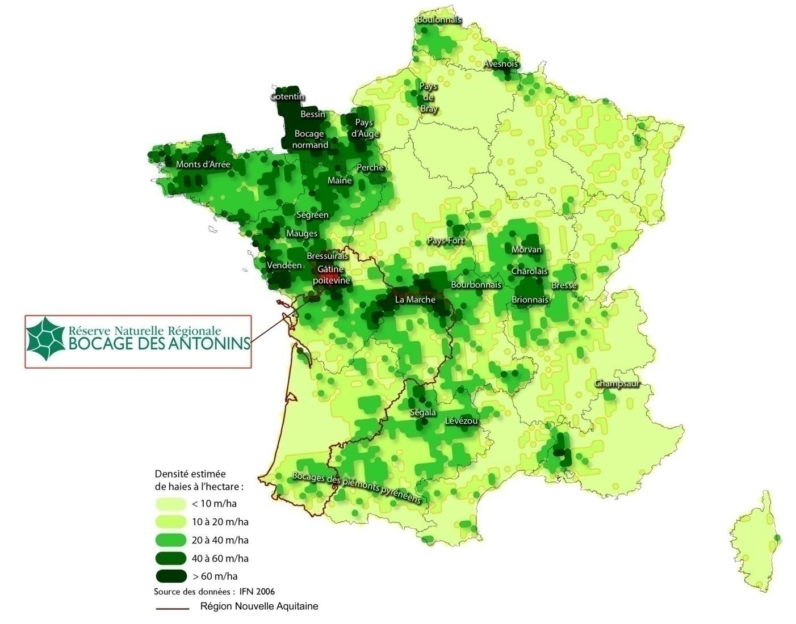
```

</div>


## Exemple : La RNR du Bocage des Antonins (79)


<div class="col2">

```{r echo=FALSE, out.width = "450px", fig.align="left"}
knitr::include_graphics("images/evolution_haies_Antonins.png")
```

```{r echo=FALSE, out.width = "300px", fig.align="right"}
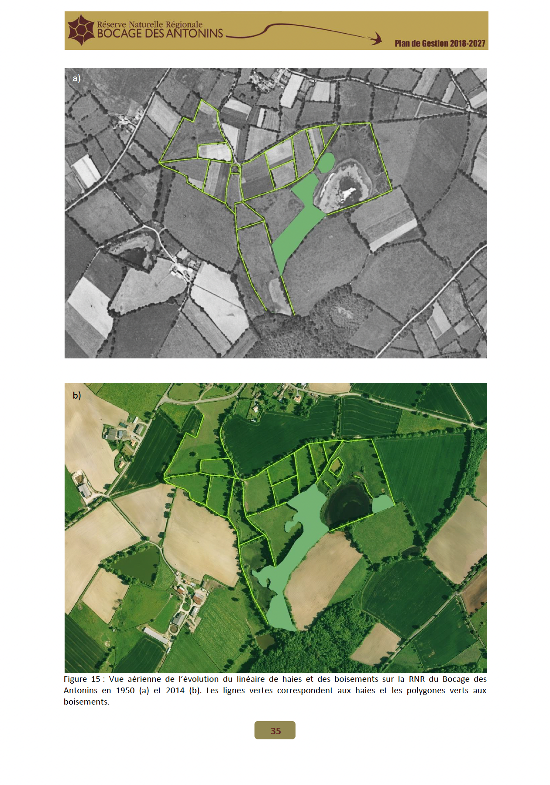
```

</div>

## Étape 2 : La définition des objectifs

- Objectifs à long terme : “l'état ou la fonctionnalité souhaitée par rapport à la situation actuelle de l'enjeu, qui doivent être visés afin de préserver cet enjeu”

- Objectifs opérationels : “facteurs naturels et anthropiques qui influencent directement ou indirectement l'existence, l'état et l'évolution des enjeux.”


## Quelques exemples

- Objectifs à long terme : Améliorer les conditions stationnelles d'une mare pour l'accueil de la faune ; Restaurer des conditions stationnelles d'ensoleillement pour l'expression des prairies et espèce associées

- Objectifs opérationnels : Restaurer équilibre en milieux ouverts et milieux forestiers

- Actions : Repousser les lisières ; Entretenir les lisières ; Entretenir une haie arbustive ; Désenvaser une mare…

## Résumé des objectifs

Étape cruciale d'un Plan de gestion.

- Notion d'état de référence

- Quelles espèces/habitats préserver ?

- Quels aménagements sont prioritaires ? Parfois, il faut faire des compromis entre les objectifs de gestion et les moyens financiers et humains à disposition. Notion d'arbitrage.

- Hiérarchisation des enjeux : arbre décisionnel implicite, parfois difficile à appliquer. Quelle espèce serait prioritaire par rapport à une autre ? Nécessité de mise en contexte de la spécificité du site.

Exemple : creuser une mare dans une prairie pour les amphibiens, mais impact sur la flore prairiale.


## Étape 3 : Les outils et moyens à déployer

- Maintien de pratiques agricoles / sylvicoles vs. non-intervention

- Aménagements particuliers (mares…)

- Adaptation des pratiques (pratiques agricoles, sylvicoles, sportives, cynégétiques…)

## Exemple avec une dimension sociologique : la RNR du Bollenberg

<div class="col2">

```{r echo=FALSE, out.width = "200px"}
knitr::include_graphics("images/Rouffach.jpeg")
```

```{r echo=FALSE, out.width = "400px"}
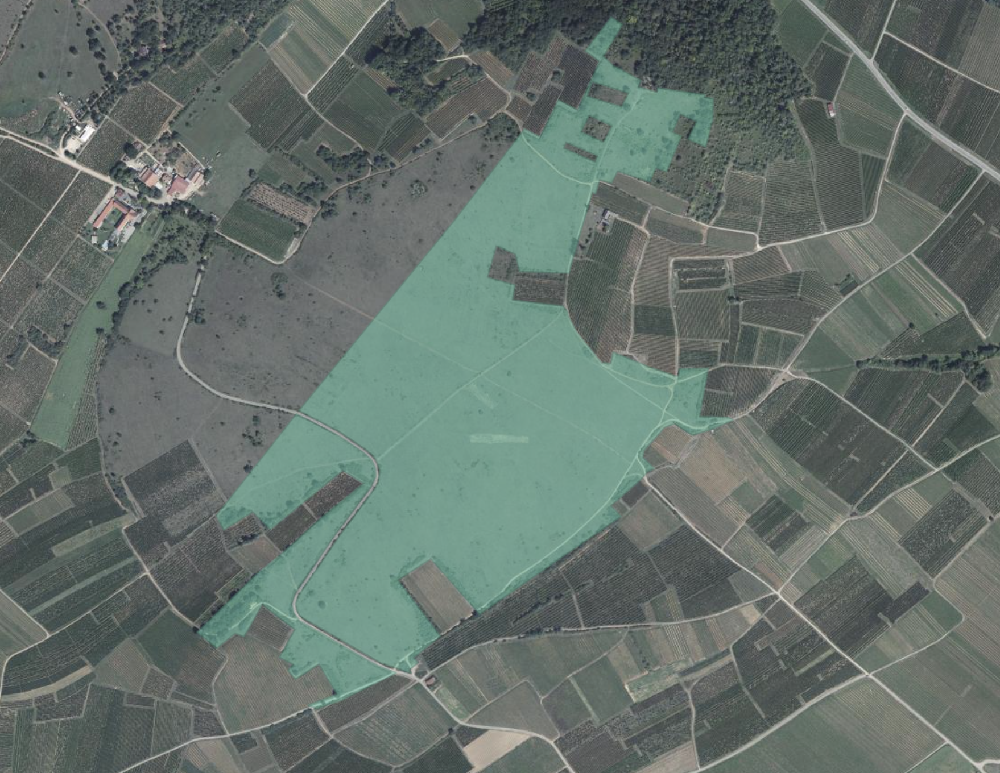
```

</div>

<font size="4">
Déplacement d'une piste d'aéromodélisme => conservation de trois plantes protégées : la Cotonnière dressée
(*Bombycilaena erecta*), Koelérie du Valais (*Koeleria vallesiana*) et Fumana à tiges retombantes (*Fumana
procumbens*). Travail de concertation et de sensibilisation. Nécessité de médiation (Comité consultatif de la RNR)
</font>


## Étape 4 : Validation

- Conseil scientifique : CNPN, CSRPN, Conseil scientifique CEN

- Comité consultatif (RNN, RNR)

- Comité de pilotage (Site Natura 2000)


## Étape 5 : Mise en œuvre

- Recherche de financement

- Travaux en régie (CEN, Départements…) ou externalisés (Entreprises privées ou publiques)

- Calendrier des travaux, des inventaires, des suivis

# Les outils pour les Plans de gestion

## Diagnostic des Habitats

Relevés de terrain (phytosociologie)

Référentiels habitats :

- Code Eunis

- Code Natura 2000 (Directive Habitat-Faune-Flore)

- Code CORINE

- Plan nationaux d'action (e.g. PNA Tourbière)

## Diagnostic des espèces

Bibliographie (littérature et BDD naturalistes) + relevés de terrain (inventaires)

- Listes rouge UICN (mondiales, nationales, régionales)
- Espèces protégées
- Liste espèces déterminantes ZNIEFF
- Référentiels taxinomique (e.g. TAXREF)
- Atlas de répartition
- Plans nationaux d'actions

## Cartographie

Utilisation du SIG pour la cartographie des enjeux :

- Cartographie des habitats

- Cartographie des espèces

- Cartographie du patrimoine géologique

- Cartographie des utilisations

# Évaluation des plans de gestion

## Comment évaluer un plan de gestion ?

- Définir des indicateurs : e.g. présence d'une espèce rare, suivi de population,fonctionnalité…

- Suivi des espèces : présence (inventaire), comptage, évaluation de critères démographiques…

- Fonctionnalité : connectivité entre les éléments, pollinisateurs, indices de reproduction, niveaux d'eau…
Notions d'écotones et de mosaïque d'habitats

L'évaluation est une étape cruciale qu'il faut planifier mais souvent difficile à mettre en œuvre.

## Exemple : la RNR du Bocage des Antonins (79)


```{r echo=FALSE, out.width = "70%", fig.align="center"}
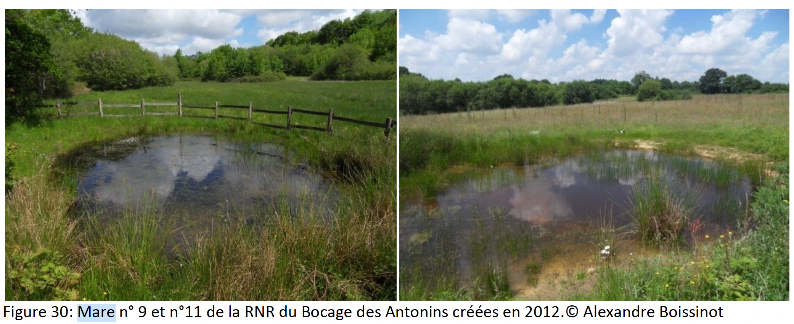
```

<div class="col2">

```{r echo=FALSE, out.width = "70%",fig.align="left"}
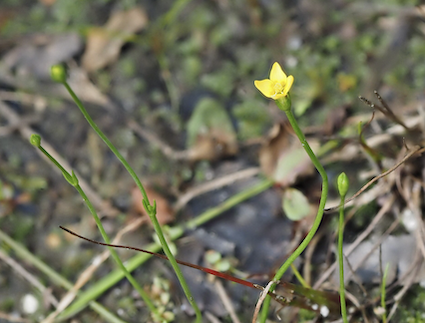
```
Cicendie filiforme (*Cicendia filiformis*), espèce connue du début XXème siècle retrouvée après creusage de mares
</div>

# Quelques références


## Pour aller plus loin
[https://ct88.espaces-naturels.fr/guide-delaboration-des-plans-de-gestion](https://ct88.espaces-naturels.fr/guide-delaboration-des-plans-de-gestion)


```{r echo=FALSE, out.width = "250px", fig.align='center'}
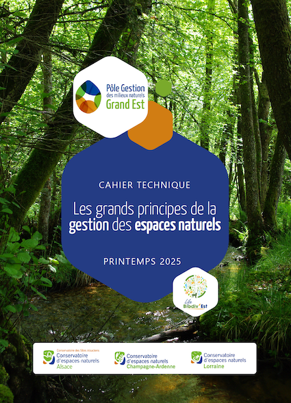
```


